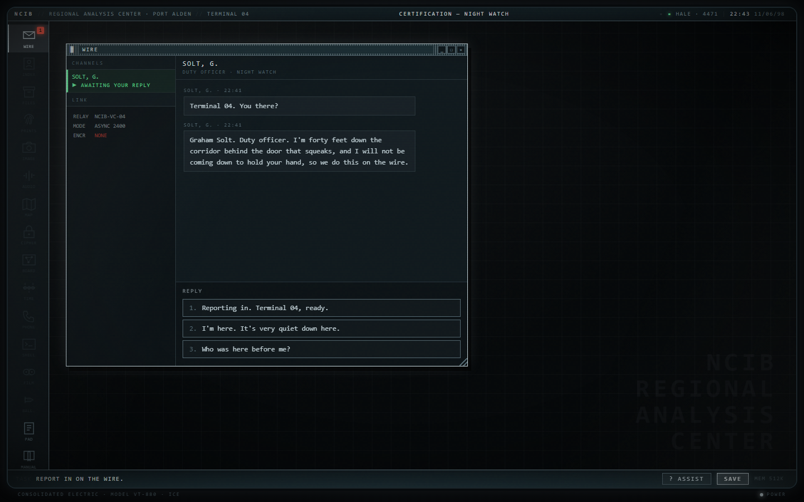

# NIGHTWIRE

## Download and play

[Download Nightwire.zip](https://github.com/businessbaum/Nightwire/releases/latest/download/Nightwire.zip), unzip it and open index.html in Chrome, Edge or Firefox. That's all. You don't need to install anything or be online, and your progress is saved in the browser.

## What is this?

A detective game at an old computer terminal in 1998. You work the night shift at a police analysis office. You don't go anywhere and you don't arrest anyone. You sit at the screen and answer questions from agents in the field.

At the start, a body is found in a flooded quarry. The fingerprint belongs to a man who died eleven years ago.

## How you play

The agents send you requests with empty fields. You search the different programs on the terminal for the right records and send them back. Some questions are multiple choice, and sometimes "no" is the right answer. Your decisions lead to one of four endings. The game has seven chapters and takes about five to seven hours.

The terminal has 17 programs that unlock over time, for example:

| Program | What you do with it |
|---|---|
| WIRE | Read and answer messages |
| REGISTRY | Search people and cars |
| ARCHIVE | Read files, reports and newspapers |
| DAKTYLO | Compare fingerprints |
| IMAGE LAB | Find details in photos |
| AUDIO LAB | Filter recordings |
| CIPHER DESK | Break codes |

If you are stuck, the ASSIST button gives you hints, starting small.

## Tips

Use headphones, because some sounds are part of the puzzles. If your browser does not save progress for local files, you can copy a save code in the CONFIG program and paste it back in later.

The keyboard works too: number keys pick a reply on the WIRE, Enter and Escape answer pop-ups, Escape closes the front window, F1 opens ASSIST, the SWITCHBOARD dials typed numbers, and Tab completes file names in the SHELL.

## How it is made

It is plain HTML, CSS and JavaScript with no libraries and no image or sound files. Everything is made in code while you play: the fingerprints, the faces, the photos and the sounds. Even the keyboard clicks are synthesized. The story and all the documents are stored as data, so a new case could be added without changing the game engine.

## Notes

All people, places and agencies in the game are made up.

## License

MIT, see [LICENSE](LICENSE).
